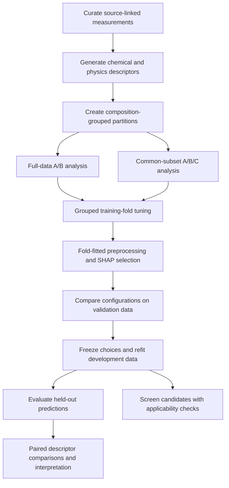

### Composition, Processing and Defect Chemistry in Stabilized Zirconia:
**A comparative machine-learning study of ionic conductivity**

**Python · Materials informatics · Matminer · Scikit-learn · SHAP**

Research code accompanying the ongoing project:

> **Composition, Processing and Defect Chemistry in Stabilized Zirconia: A Comparative Machine Learning Study of Ionic Conductivity**  
> Md Mir Musharuf Hussain Rony

**Status:** Research in progress. A publication DOI and formal citation will be added when available.

## Overview

The ionic conductivity of zirconia-based electrolytes depends on chemical composition, fabrication history and defect chemistry. Literature measurements provide a valuable basis for studying these relationships, but variation in reporting, repeated measurements and incomplete material descriptions complicate predictive modelling.

This project investigates how three groups of descriptors contribute to conductivity prediction: **chemical features**, **processing conditions** and **nominal physics-based features**. It combines formula-derived elemental descriptors with reported sintering conditions and source-supported defect-chemistry assignments, then compares progressively expanded feature sets using composition-grouped evaluation.

The principal objective is to quantify the additional predictive value of processing and physics-based information. A descriptor's importance to a fitted model and its ability to improve held-out predictions are evaluated separately. SHAP associations are interpreted as model explanations, not demonstrations of physical causality.

This README describes the revised feature configuration. Numerical results, figures and candidate rankings from an earlier configuration must be regenerated and checked before they are attributed to this version.

## Research Questions

1. How well do chemical descriptors predict conductivity for held-out compositions?
2. Does adding sintering information improve prediction on the same observations?
3. Do explicit defect-chemistry descriptors add predictive value beyond chemical and processing features?
4. Are these contributions consistent across regression algorithms and composition groups?
5. Can the resulting models support a qualified shortlist of candidate compositions and processing schedules?

## Key Features

### Composition-Based Chemical Featurization

Chemical formulas are converted into elemental-property descriptors using the **Magpie preset in matminer**. These features summarize constituent-element properties through composition-dependent statistics.

Original nominal formulas are preserved in the source records. A consistent composition identity is used for grouping equivalent formulas during evaluation. Elemental descriptors do not directly measure phase fractions, local structure or defect arrangements in a synthesized specimen.

### Controlled Feature-Set Comparisons

| Feature set | Included information | Scientific purpose |
| --- | --- | --- |
| **A: Chemical** | Composition-derived elemental descriptors | Establish chemical-information performance |
| **B: Chemical + processing** | Set A plus sintering temperature and time | Test the added value of processing information |
| **C: Chemical + processing + physics** | Set B plus five nominal physics-based descriptors | Test the added value of explicit defect-chemistry and size descriptors |

Sets A and B use the full dataset. A separate comparison evaluates **A, B and C on identical physics-complete records and partition assignments**. Full-data B and subset C scores cannot isolate a physics-feature contribution because their evaluation populations differ.

### Source-Supported Physics Descriptors

| Descriptor | Interpretation |
| --- | --- |
| Dopant cation fraction | Cation fraction assigned to dopants under the documented composition convention |
| Mean dopant valence | Weighted mean of assigned dopant oxidation states |
| Nominal oxygen vacancies per cation | Charge-balance estimate under explicit valence and compensation assumptions |
| Ionic-radius mismatch | Nominal size mismatch relative to the reference cation |
| Cation-radius variance | Dispersion of assigned cation radii, expressed in Ų |

Coordination assignments of **CN5, CN6 and CN8** are used where supported by the source information. Spin state is not a model input. This does not make ionic radii independent of spin state: ambiguous radius assignments require review rather than arbitrary selection.

Nominal vacancy estimates do not measure the concentration of mobile vacancies. Radius mismatch and radius variance are size descriptors, not experimental measurements of lattice distortion. Unsupported assignments remain missing. The precise equations, radius conventions and oxidation-state assumptions must accompany any reported results.

### Grouped Evaluation and Fold-Specific Selection

Equivalent compositions are kept together across partitions. Imputation, constant-feature removal, scaling and SHAP-based selection are fitted inside the relevant training folds. This prevents held-out targets from influencing those fitted operations during tuning.

### Interpretable Model Benchmarking

The workflow compares eight regression families, produces regression and optional threshold-classification summaries, and exports figures and result tables. Final-model SHAP plots describe fitted predictions and are distinct from the Random Forest SHAP selector used during preprocessing.

## Dataset and Curation

The current database contains:

| Quantity | Full dataset | Physics-complete subset |
| --- | ---: | ---: |
| Measurement records | 1,483 | 649 |
| Composition groups | 147 | 61 |
| Literature source identifiers | 39 | 31 |

Conductivity values were compiled from published tables and digitized figures. Formula records, units and source identifiers support traceability. A measurement record is not necessarily an independent material or experiment: multiple rows can come from the same sample, composition or publication.

The database is predominantly YSZ-related. Claims covering all stabilized-zirconia families require broader representative sampling. Bulk, grain-boundary and total ceramic conductivity are different quantities; retained differences in measurement definition and material form must be documented in the manuscript. Source linkage alone does not establish independent verification of every extracted value.

**Grain size and relative density are excluded because of extensive missing data.** Their missing fractions in the inspected database were approximately **83.95%** and **64.33%**, respectively. Removing them reduces dependence on heavily imputed microstructure information but limits direct assessment of microstructural contributions.

Activation energy is excluded from the predictors and is not a prediction target in this project. Phase information and source identifiers are metadata where available, rather than automatic model inputs.

## Prediction Target

The regression target is:

```text
y = log10[σ / (S cm⁻¹)]
```

MAE and RMSE are reported in log10 units; R² is dimensionless. R² should not be described as percentage prediction accuracy.

Records with identical retained inputs but different conductivities cannot be individually distinguished by a deterministic regression model. This unresolved variation limits the interpretation and achievable precision of predictions.

## Workflow Architecture



## Models and Evaluation

### Regression Algorithms

| Model | Role in the comparison |
| --- | --- |
| Ridge regression | Regularized linear relationship |
| Support vector regression | Kernel-based nonlinear relationship |
| K-nearest neighbours | Similarity-based prediction |
| Random Forest | Ensemble of randomized decision trees |
| Extra Trees | Ensemble with additional split randomization |
| Gradient Boosting | Sequential correction of residual errors |
| XGBoost | Regularized gradient-boosted trees |
| Artificial neural network | Multilayer perceptron using scikit-learn's `MLPRegressor` |

The ANN implementation does not require TensorFlow.

### Training, Validation and Test Partitions

The master split assigns composition groups to approximately 80% training, 10% validation and 10% test partitions. Group sizes make row proportions approximate. The common subset inherits the master assignments.

| Analysis | Training rows | Validation rows | Test rows | Test composition groups |
| --- | ---: | ---: | ---: | ---: |
| Full dataset | 1,222 | 140 | 121 | 15 |
| Common subset | 578 | 40 | 31 | 5 |

These counts describe the existing split manifest and must be checked following a data revision. Composition grouping assesses transfer to held-out compositions; it does not establish transfer to unseen papers. All 39 full-data source identifiers occur in the training partition.

### Hyperparameter Tuning

The implemented protocol uses grouped five-fold cross-validation within the training partition and randomized search with up to 20 configurations per algorithm and feature set.

Inside each fold, the pipeline fits:

1. Missing-value imputation, where required.
2. Constant-feature removal and standardization.
3. A Random Forest SHAP selector retaining up to 30 features.
4. The regression estimator under the candidate hyperparameters.

Mean fold RMSE selects hyperparameters. Validation RMSE then identifies the primary model for each analysis and feature set. Frozen configurations are refitted on training plus validation data before test evaluation. The eight-model benchmark is reported separately from the validation-selected primary models.

Tuning scores are selection statistics, not final independent test estimates. Original test outcomes have already been inspected; a revised analysis using the same test observations must disclose this history rather than describe those observations as newly untouched.

### Performance and Interpretation

Main outputs include R², MAE, RMSE, parity plots, residual summaries and composition-level errors. Comparisons use paired observations and the same algorithm family to assess A versus B and B versus C.

With a fixed top-30 selection rule, adding descriptors can replace previously selected chemical features. Consequently, the comparison evaluates complete selected-feature pipelines. It does not hold every original predictor fixed.

SHAP bar plots summarize mean absolute attribution, while beeswarm plots show attribution direction and spread. Correlated features can redistribute attribution. A feature's absence from the selected set does not establish physical irrelevance.

Optional high/low-conductivity analysis applies a predefined threshold to regression predictions. Confusion matrices, classification reports, precision, recall, F1, ROC curves and precision–recall curves supplement regression metrics. Predicted conductivity is a ranking score for these curves, not a calibrated class probability. PR AUC and average precision must be labelled according to the quantity actually computed.

## Uncertainty and Candidate Screening

Composition-level bootstrap resampling assesses variability in fitted predictions. Preprocessing and feature selection are repeated while the selected hyperparameters remain fixed. Bootstrap spread does not automatically constitute a calibrated experimental prediction interval.

Candidate screening combines nominal Y/Sc zirconia compositions with specified processing schedules. The candidate inputs must match the fitted feature definitions. Full-data A and B pipelines support the screening, and model B provides the principal ranking. Descriptor-range and distance checks identify candidates outside the adopted applicability criteria.

Candidate lists are computational proposals. They do not demonstrate phase stability, synthesis feasibility or experimentally confirmed improvement. A composition absent from this database is not necessarily new to the literature. Rankings must be regenerated after changing model inputs.

Bayesian optimization and activation-energy prediction are outside the current scope.

## Getting Started

### Prerequisites

- Python and a compatible set of package versions from the corresponding analysis environment.
- VS Code with the Python and Jupyter extensions for running `# %%` cells.
- The private input workbooks for executing the complete analysis.

The development environment reported for this project uses Python 3.14.6 on 64-bit Windows. Compatibility with other Python versions has not been established here. The run's recorded versions should be used when reproducing a specific output.

### Installation

Download or clone this repository, open its root folder in VS Code, and create a virtual environment. From a Windows PowerShell terminal:

```powershell
python -m venv .venv
.\.venv\Scripts\python.exe -m pip install --upgrade pip
.\.venv\Scripts\python.exe -m pip install -r requirements.txt
```

The repository should include `requirements.txt` exported from the working analysis environment. Major dependencies are NumPy, pandas, SciPy, scikit-learn, matminer, pymatgen, SHAP, XGBoost, Matplotlib, seaborn, joblib, cloudpickle, openpyxl and tqdm.

Select `.venv` as both the Python interpreter and the interactive kernel. The environment itself is local and is not committed to Git.

### Quick Start

1. Place authorized copies of the required workbooks in `Dataset/`.
2. Open `src/sourcecode.py` and check its project path, input filenames and worksheet settings.
3. Run the numbered `# %%` cells in sequence using **Run Cell**.
4. Inspect row matching, descriptor coverage, actual feature membership and split manifests before model fitting.
5. Review outputs saved under `Figures/` and `Results/`.

The main workbook is `Book1 auto.xlsx`, with worksheet `YSZ Data`. The physics input compilation uses the `Compositions` and `Ion_Assignments` worksheets. Use the exact filenames and column names configured in the script; the private files are not downloaded automatically.

This is an interactive research script, not an installable command-line package. Re-running a late cell requires the earlier cells' objects to exist in the active kernel.

## Repository Structure

| Path | Contents |
| --- | --- |
| `src/sourcecode.py` | Main analysis, organized into numbered cells |
| `Figures/` | Regression comparisons, parity and residual plots, SHAP plots and screening figures |
| `Results/` | Selected metrics, search summaries, predictions, interpretation tables and screening outputs |
| `Dataset/` | Private local workbooks; excluded from Git |
| `.venv/` | Local Python environment; excluded from Git |
| `.gitignore` | Private-data and local-file exclusions |
| `requirements.txt` | Dependencies exported from the working environment |
| `README.md` | Project documentation |

## Output Organization

| Output category | Purpose |
| --- | --- |
| Partition and coverage summaries | Document evaluated populations and descriptor availability |
| Tuning tables | Record parameter candidates, fold metrics and selected configurations |
| Validation and test tables | Distinguish selection results from held-out evaluation |
| Paired feature comparisons | Quantify descriptor additions on common observations |
| SHAP rankings and figures | Explain selection and final-model attribution |
| Classification summaries | Evaluate a predefined high/low threshold |
| Candidate shortlists | Report conditional predictions and applicability information |

Keep outputs from distinct runs separate and preserve their configuration records. Published tables should identify the feature set, population, algorithm, split and target scale. Avoid selecting the headline model solely because it achieves the best score after inspecting all test results.

## Data Availability and Reproducibility

**The curated datasets and descriptor-input workbooks are not publicly distributed in this repository.** They remain in the ignored `Dataset/` directory. Code and selected research outputs are shared to document the analysis.

The public repository alone cannot reproduce the numerical results without the matching input data. Reproduction also requires the composition identities, split manifest, descriptor assignments, dependency versions and run settings.

Excluding a directory from Git does not remove it from earlier commits. It also does not remove measurement values embedded in prediction tables, feature exports, figures or cached files. Public outputs should be reviewed individually before release.

## Troubleshooting

| Issue | Action |
| --- | --- |
| Workbook not found | Check the project root, exact filename, worksheet and local availability of the private inputs |
| Excel permission error | Close the workbook in Excel and ensure OneDrive has downloaded it locally |
| Import error | Confirm that VS Code and its interactive kernel use the same environment |
| Undefined object in a later cell | Run the prerequisite cells in order after a kernel restart |
| Joblib cache warning | Use a short writable local cache path outside OneDrive, or disable pipeline caching |
| Cloudpickle import failure | Use the standalone `cloudpickle` package rather than a bundled internal import |
| Missing physics assignments | Review formula/source matching, oxidation states and radius assignments; do not invent replacements |

## Limitations

The analysis is constrained by literature heterogeneity, incomplete descriptor coverage and unequal numbers of records per composition. The common-subset test includes only five composition groups, limiting the strength of broad generalization claims.

The complete-case subset may preferentially represent compositions with better documented chemistry. Nominal defect descriptors depend on assumptions and may not describe actual defects or multiphase materials adequately. Processing associations can reflect source and composition differences as well as fabrication effects.

No universal improvement from physics descriptors is presumed. The intended contribution is to identify where added descriptor groups improve held-out prediction and where their benefit is limited.

## Roadmap

- Regenerate and verify results for the revised feature configuration.
- Expand coverage of independently reported zirconia compositions.
- Improve documentation of phase, oxidation-state and coordination assignments.
- Add paper-held-out evaluation and feature-selection sensitivity analyses.
- Test candidate predictions using independent measurements or suitable simulations.

## Citation and Publication Status

This project is ongoing. A peer-reviewed paper citation and DOI are not yet supplied. If referencing the code, identify the repository, author and exact commit or archived release used. A formal citation entry will be added when publication or archival metadata are available.

## Contributing

Suggestions addressing implementation errors, descriptor definitions, validation and documentation are welcome through repository issues and pull requests. Explain the scientific motivation for methodological changes and keep private data out of contributions.

## License

A software license has not yet been specified in this documentation. Consult the repository's actual license file, if provided, for reuse terms. Data availability is separate from software licensing; the private datasets are not included in the code release.

## Acknowledgments

This work uses open-source scientific Python tools, including matminer, pymatgen, scikit-learn, SHAP, XGBoost, NumPy, pandas, SciPy and Matplotlib. The original experimental publications provide the scientific basis for the curated measurements and should be cited in the accompanying manuscript.

## Author and Contact

**Md Mir Musharuf Hussain Rony**  
B.Sc. in Mechanical Engineering, Rajshahi University of Engineering & Technology, Bangladesh.

Questions about the implementation and research workflow can be raised through GitHub Issues once the repository is published.
